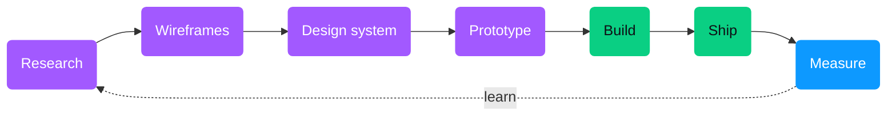

<a href="https://github.com/jlouisce">
  
</a>

<div align="center">

[](https://www.linkedin.com/in/jonnathan-luis/)
[](https://www.instagram.com/jlouisce/)
[](mailto:jonnathanesmen3@gmail.com)
[](https://github.com/jlouisce/OGX)

</div>

## Hi, I'm Luis 👋

I started as a **UI/UX designer** and ended up building the whole thing: from the first wireframe in Figma to the API, the database and the deploy. Today I work as a **Full Stack Developer & UI/UX Designer at [Melora Connect](https://meloraconnect.com)**, run my own software studio, **OGX**, and study at **Universidad Icesi** 🇨🇴.

I care about products that feel obvious to use and code that is boring to maintain. That is a compliment.

```ts
const luis = {
  role:      ["Full Stack Developer", "UI/UX Designer"],
  basedIn:   "Colombia 🇨🇴",
  now: {
    work:     "Melora Connect · membership software for associations",
    studio:   "OGX · web apps and sites for real clients",
    building: "CloudMed · practice management for dental clinics",
    studying: "Universidad Icesi",
  },
  workflow:  "Research → Figma → Design system → TypeScript → Ship",
  certified: ["Google · Generative AI Leader"],
  askMeAbout: ["design systems", "multi-tenant SaaS", "AI agents in dev workflows"],
};
```

---

## 🧩 Selected work

<table>
  <tr>
    <td width="50%" valign="top">
      <h3>🏛️ OGX</h3>
      <p>My software studio. The site is getting a full redesign: editorial, monochrome and bilingual (EN / ES), showing real projects and clients instead of filler.</p>
      <p></p>
      <p><sub><b>TypeScript · React · Supabase · Tailwind</b></sub></p>
      <a href="https://github.com/jlouisce/OGX">View repo →</a>
    </td>
    <td width="50%" valign="top">
      <h3>🦷 CloudMed</h3>
      <p>Practice management for dental clinics in Colombia, from solo dentists to multi-chair clinics. Designed screen by screen in Figma before a single line of code.</p>
      <p></p>
      <p><sub><b>Next.js · Node/Express · PostgreSQL (multi-tenant) · Docker · AWS</b></sub><br/>
      <sub>Encryption at rest and in transit · role-based access · permanent audit log</sub></p>
    </td>
  </tr>
  <tr>
    <td width="50%" valign="top">
      <h3>💎 Want Me</h3>
      <p>E-commerce web app for custom pendants with color variations and a personalization flow. Built under OGX with feedback straight from the client.</p>
      <p></p>
      <p><sub><b>React · TypeScript · AWS · DynamoDB</b></sub></p>
    </td>
    <td width="50%" valign="top">
      <h3>🤝 JGMC</h3>
      <p>Website for JGMC Human Capital Consulting, a firm that connects the right talent with each organization's needs. I built most of it.</p>
      <p></p>
      <p><sub><b>React · TypeScript · Tailwind</b></sub></p>
    </td>
  </tr>
</table>

---

## 🎨 How I work

Design and code are the same job to me, just different tools.



---

## 🛠️ Toolbox

<table>
  <tr>
    <td><b>Design</b></td>
    <td></td>
  </tr>
  <tr>
    <td><b>Frontend</b></td>
    <td></td>
  </tr>
  <tr>
    <td><b>Backend</b></td>
    <td></td>
  </tr>
  <tr>
    <td><b>Data</b></td>
    <td></td>
  </tr>
  <tr>
    <td><b>Cloud & DevOps</b></td>
    <td></td>
  </tr>
  <tr>
    <td><b>AI</b></td>
    <td>
      
      
      
      
    </td>
  </tr>
</table>

<details>
<summary><b>🔍 A few more things about me</b></summary>
<br/>

- 🎨 I was a designer first, so I still open Figma before I open the editor.
- 🧱 I like building design systems: tokens, components and the rules that keep a product consistent.
- 🤖 I use AI agents as part of my daily dev workflow, and I've helped bring them into a team's process.
- 📊 Statistics class taught me to love R more than I expected.
- 🎯 Goal for this year: grow towards senior, one well-shipped project at a time.

</details>

---

## 📈 Activity

<p align="center">
  <picture>
    <source media="(prefers-color-scheme: dark)" srcset="https://github-readme-stats-eight-theta.vercel.app/api?username=jlouisce&show_icons=true&include_all_commits=true&count_private=true&hide_border=true&theme=github_dark&icon_color=A259FF&title_color=F5F5F7"/>
    
  </picture>
  <picture>
    <source media="(prefers-color-scheme: dark)" srcset="https://github-readme-stats-eight-theta.vercel.app/api/top-langs/?username=jlouisce&layout=compact&hide_border=true&theme=github_dark&title_color=F5F5F7"/>
    
  </picture>
</p>

<p align="center">
  <picture>
    <source media="(prefers-color-scheme: dark)" srcset="https://raw.githubusercontent.com/jlouisce/jlouisce/output/snake-dark.svg"/>
    
  </picture>
</p>

---

## 📫 Let's build something

Have a product that needs to look good **and** work well? Or just want to talk design systems? My inbox is open.

<div align="center">

**[jonnathanesmen3@gmail.com](mailto:jonnathanesmen3@gmail.com)** · **[LinkedIn](https://www.linkedin.com/in/jonnathan-luis/)** · **[Instagram](https://www.instagram.com/jlouisce/)**

<br/>

<sub>Designed in Figma. Built in TypeScript. Shipped from Colombia.</sub>

<br/><br/>


</div>
